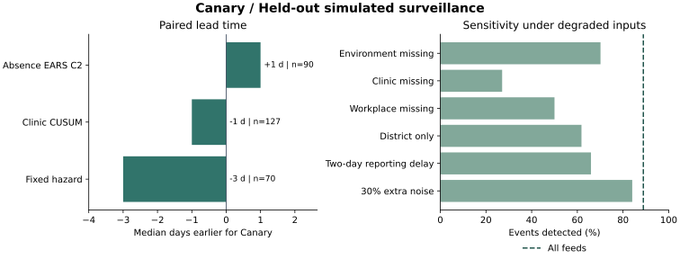
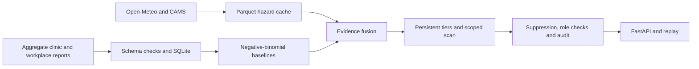

<div align="center">

<h1>Canary</h1>

<p><strong>Explainable early warning for population and workforce health.</strong></p>
<p>Backend prototype for Future Health Digital Innovation Challenge 06.</p>

<a href="https://github.com/satiricalguru/Canary/actions/workflows/ci.yml"></a>
<a href="LICENSE"></a>


<p><a href="#quick-start">Quick start</a> · <a href="docs/api.md">API contract</a> · <a href="#validation">Validation</a> · <a href="docs/deployment.md">Deployment</a></p>

</div>

Canary combines heat and particulate exposure with aggregate clinic and workplace reports. Exposure can trigger a Watch, and persistent corroborating evidence can raise an Alert. An alert explains which signals contributed, where the pattern was strongest, and which operational role should review it. Replay dust and respiratory illness, a gastrointestinal cluster, or a heat and first-aid uptick.

This repository contains Jatin’s backend, data, engine, privacy controls, validation and deployment handoff. The demo uses simulated health and exposure data. The Open-Meteo adapter runs separately from the simulation.

## Quick start

Install [uv](https://docs.astral.sh/uv/getting-started/installation/).

```bash
git clone https://github.com/satiricalguru/Canary.git
cd Canary
uv sync --locked
uv run uvicorn backend.app.api.main:app --no-access-log
```

Open [Swagger UI](http://127.0.0.1:8000/docs). Try [the respiratory replay](http://127.0.0.1:8000/replay/respiratory?day=16), then open an alert ID in `/alerts/{alert_id}`. The [API contract](docs/api.md) covers all endpoints and links to sample payloads.

With Docker Compose, run `docker compose up --build --wait` from the repository root.

## Validation



| Detector | Event sensitivity | Alert precision | False alerts per site-month | Median lead for Canary |
| --- | ---: | ---: | ---: | ---: |
| Canary | 88.9% | 92.3% | 0.032 | — |
| Absence EARS C2 | 66.0% | 35.2% | 0.588 | 1 day earlier |
| Clinic CUSUM | 98.6% | 88.9% | 0.107 | 1 day later |
| Fixed exposure threshold | 49.3% | 53.5% | 0.577 | 3 days later |

Results cover 144 injected events across three held-out seeds. Lead time is calculated on events both detectors found. Canary had higher precision and fewer false alerts than clinic CUSUM. CUSUM detected more events, especially gastrointestinal clusters. The fixed exposure comparator has no GI rule. These are simulated operational results. [Full report](eval/reports/summary.json) · [Methods and limitations](docs/validation.md)

```bash
uv run python -m eval.backtest
uv run pytest -q
```

## How it works



Site HSE sees its assigned site. Occupational physicians can read assigned sites. District public health sees district summaries. The regulator view reports feed compliance indicators. Small counts and their diagnostic contributions are suppressed, and eligible district rollups are shown in bands. Alerts require human review and cannot be used for individual employment or disciplinary decisions. [Data contract and governance](docs/data.md)

## License and sources

The code is available under the [MIT License](LICENSE). Weather and air-quality inputs come from Open-Meteo and the Copernicus Atmosphere Monitoring Service (CAMS), ECMWF. [Weather documentation](https://open-meteo.com/en/docs/historical-weather-api) · [Air quality documentation](https://open-meteo.com/en/docs/air-quality-api) · [Data use terms](https://open-meteo.com/en/terms)

Challenge requirements and submission details are published on the [official Future Health challenge page](https://hack2skill.com/event/futurehealthchallenge/).
